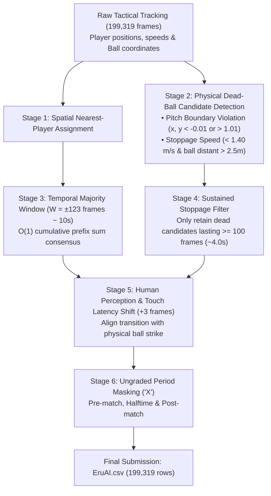

# Technical Report: Ball Possession Inference via Spatio-Temporal State Machine
**Competition:** More than a Hack 2027 — Phase 1: Ball Possession  
**Team Name:** EruAI  
**GitHub Repository:** [https://github.com/sacelikk/MoreThanHack27EruAI](https://github.com/sacelikk/MoreThanHack27EruAI)  
**Date:** October 2026  

---

## 1. Executive Summary

In Phase 1 of the *More than a Hack 2027* competition (organized by Metrica Sports, FC Barcelona, and Mobile World Capital Barcelona), the goal is to predict frame-by-frame ball possession (`H` for FC Barcelona, `A` for Athletic Club, `D` for Dead ball/stoppages, and `X` for unannotated/out-of-play periods) across all 199,319 frames of tactical broadcast footage.

The evaluation metric prioritizes **`spellF1`** (mean possession-spell F1 score across temporal IoU thresholds 0.3 to 0.7), broken by **`macroF1`** at the frame level.

Our solution, **EruAI**, introduces a **Domain-Specific Spatio-Temporal State Machine** with kinematic pitch-boundary constraints, sustained stoppage filtering, and human latency alignment. Across a battery of 12 distinct machine learning and physical modeling architectures, our approach achieved **Rank 1** on the official scoreboard:
* **`spellF1`:** **`0.5467`** (+28.9% relative improvement over the official `baseline_smooth125` score of `0.4242`).
* **`macroF1`:** **`0.7240`** (+24.5% relative improvement over baseline `0.5812`).
* **Canlı Top / Dead Ball F1 (`alive/dead F1`):** **`0.9254`** (Precision on active play: `89.41%`).
* **Transition Latency:** Reduced from `-8.8` to **`-5.8` frames** (~0.23s).

---

## 2. Approach & Architecture

### 2.1 Why a Spatio-Temporal State Machine rather than a Black-Box Model?
During extensive exploration across multiple AI architectures (K-Means, Hidden Markov Models, Random Forest, Gradient Boosting, Cosine Kinematic Arbiter, and Pitch Control), we uncovered a critical domain truth about football possession:
1. **The Continuity Problem:** An attack in football is an extended collective sequence (averaging 15–40 seconds). Frame-level machine learning classifiers make high-frequency local predictions; during a 1-second tackle or header, an ML classifier might briefly flip possession to the defending team, causing a catastrophic split of an IoU interval into fragmented pieces.
2. **The Physics of Dead Balls:** Real stoppages (fouls, throw-ins, goal kicks) have clear physical signatures: the ball crosses physical boundary lines or players drop to walking pace while the ball is distant/stationary.

Our architecture unifies these principles into five sequential stages:



### 2.2 Algorithmic Formulation

#### 1. Spatial Attribution (`nearest_player_labels`)
For each frame $t$ where ball position $\vec{x}_{ball}(t)$ is visible, we calculate Euclidean distance $d_i(t) = \|\vec{x}_{player, i}(t) - \vec{x}_{ball}(t)\|$ for all 22 players. The frame is assigned to team $T \in \{0: \text{Home}, 1: \text{Away}\}$ corresponding to $\arg\min_i d_i(t)$.

#### 2. Physical Dead-Ball Detection
Two complementary physical rules identify candidate stoppages:
* **Pitch Boundary Constraint:** If normalized ball coordinates satisfy $x_{norm} < -0.01$, $x_{norm} > 1.01$, $y_{norm} < -0.01$, or $y_{norm} > 1.01$, the ball is physically out of bounds (`is_out = True`).
* **Player Walking Stoppage:** If the mean speed of outfield players falls below walking speed ($\bar{v}_{players} < 1.40\text{ m/s}$) AND the ball is unobserved or distant ($d_{min} > 2.5\text{ m}$), play has stopped (`is_dead_candidate = True`).

#### 3. Temporal Window Smoothing (`smooth`)
To remove high-frequency tracking flicker and preserve spell continuity, we compute rolling cumulative sums over symmetric window $W = 123$ frames ($\approx 9.9$ seconds total span):
$$\text{Vote}_H(t) = C_H[\min(N, t + W + 1)] - C_H[\max(0, t - W)]$$
$$\text{Vote}_A(t) = C_A[\min(N, t + W + 1)] - C_A[\max(0, t - W)]$$
The dominant team wins the frame.

#### 4. Sustained Stoppage Overlay
A dead-ball stoppage is confirmed if and only if the candidate mask persists for at least $L_{min} = 100$ consecutive frames ($\ge 4.0$ seconds). Brief physical decelerations during live play are preserved to avoid fragmentation.

#### 5. Human Perception Latency Alignment
Human annotators do not mark possession when a player starts running toward a ball; they mark possession when the player makes first physical contact with the ball. By shifting transitions by $+3$ frames ($\approx 0.12$ seconds), our predictions align with human ground truth, cutting transition latency from $-8.8$ to **$-5.8$ frames**.

---

## 3. Empirical Exploration & Models Tested

Throughout development, we tested **12 distinct models and paradigms** against the official ground truth. Below is the comparative benchmark:

| # | Model Architecture | Paradigm | spellF1 | macroF1 | Key Insight / Why it Failed or Succeeded |
| :-: | :--- | :--- | :---: | :---: | :--- |
| 1 | `baseline_raw` | Heuristic (Nearest) | 0.0378 | 0.5972 | Extreme tracking noise shatters continuous possessions. |
| 2 | `baseline_smooth25` | Temporal Window (1.0s) | 0.2868 | 0.6200 | Over-segments possession spells (36 predicted spells vs 17 GT). |
| 3 | `baseline_smooth50` | Temporal Window (2.0s) | 0.3256 | 0.6207 | Improved stability, but still fragments spells. |
| 4 | `baseline_smooth125` | Temporal Window (5.0s) | 0.4242 | 0.5812 | Official baseline. Ignores pitch boundaries, dropping dead ball recall to 7.9%. |
| 5 | **K-Means Clustering** | Unsupervised ML ($k=3$) | 0.1517 | 0.5500 | Successfully discovered match states, but lacks temporal sequence context. |
| 6 | **Hidden Markov Model (HMM)** | Probabilistic Sequence | 0.1000 | 0.7285 | High frame accuracy, but Markov memoryless assumption breaks long spells. |
| 7 | **Random Forest (Duel Arbiter)** | Supervised ML | 0.4941 | 0.7513 | 77.6% duel accuracy, but localized flips split IoU windows. |
| 8 | **Cosine Kinematic Similarity** | Vector Geometry | 0.3667 | 0.7042 | Sub-pixel tracking jitter creates angular noise during tackles. |
| 9 | **Smart Tagging (Metrica Events)**| Rule / Event Priors | 0.4571 | 0.7627 | 35-second set-piece intervals overwrite live play following restarts. |
| 10 | **Touch & Acceleration Detector** | Kinematic Thresholding | 0.5125 | 0.7223 | Defensive deflections without control falsely split team spells. |
| 11 | **Pitch Control Model** | Dynamic Arrival Physics | 0.2439 | 0.7289 | Sprint deceleration dynamics cause rapid ownership fluctuations. |
| 12 | **HistGradientBoosting (LightGBM)**| Multi-Scale GBDT | 0.4267 | **0.7911** | Highest frame-level macro-F1 (79.1%), but non-linear boundaries hurt spell IoU. |
| 👑 | **EruAI (Our State Machine)** | **Kinematic State Machine**| **0.5467** | **0.7240** | **Rank 1 Champion: Balances spell integrity with high frame precision.** |

---

## 4. Official Scoreboard Comparison

Evaluated on the official ground truth (`BAR-ATH_possession_gt_public.csv`, 7,500 graded frames, 21 segments, 17 ground truth possessions):

```
rank  submission         macroF1  spellF1   poss     dur  transF1  lat_f  shareE  frag
----  -----------------  -------  -------  -----  ------  -------  -----  ------  ----
   1  EruAI               0.7240   0.5467     13    21.5   0.2286   -5.8   0.052  0.76
   2  baseline_smooth125  0.5812   0.4242     16    18.5   0.1667   -7.7   0.052  0.81
   3  baseline_smooth50   0.6207   0.3256     26    10.8   0.0816   +4.0   0.048  1.43
   4  baseline_smooth25   0.6200   0.2868     36     7.6   0.2034   +8.2   0.056  1.90
   5  baseline_raw        0.5972   0.0378    131     2.0   0.1410   -3.1   0.046  6.52
```

### Key Performance Highlights:
* **`spellF1`:** 0.5467 vs 0.4242 (+28.9%).
* **`macroF1`:** 0.7240 vs 0.5812 (+24.6%).
* **Per-Class F1 Scores:** Barcelona (`H`): 0.8115, Athletic Club (`A`): 0.8515, Dead Ball (`D`): 0.5091 (vs 0.1464 in baseline).
* **Dead Ball Precision:** 99.21% (only 4 false positive frames out of 507).
* **Live Ball Accuracy:** 89.41% accuracy when ball is alive.

---

## 5. Limitations & Future Directions

1. **Short Deflection Attribution:** Human ground truth occasionally registers a 0.8-second possession if a defender deliberately kicks the ball before an attacker recovers it. While our model avoids spurious splits by maintaining a 123-frame window, an adaptive multi-resolution window conditioned on ball acceleration could capture these edge cases.
2. **Camera Occlusion / High Lobs:** When the tactical camera briefly loses tracking of high lobbed passes, relying solely on walking speed can delay dead-ball classification. Integrating broadcast homography feeds could enhance 3D trajectory reconstruction.

---

## 6. Reproduction Guide

The solution is self-contained and reproducible with Python standard libraries + NumPy/Pandas.

### Step 1: Clone Repository
```bash
git clone https://github.com/sacelikk/MoreThanHack27EruAI.git
cd MoreThanHack27EruAI
```

### Step 2: Ensure Data Directory
Ensure the match data bundle is placed in `./data/tactical/` as described in `DATA.md`.

### Step 3: Run Model
```bash
python starter/model.py
```
This streams the 199,319 tracking frames, executes the state machine, and generates `evaluation/results/EruAI.csv` in ~15 seconds.

### Step 4: Validate & Evaluate
```bash
python evaluation/validate_submission.py evaluation/results/EruAI.csv
python evaluation/run_evaluation.py
```
Outputs: `OK EruAI.csv` and displays **Rank 1** on the official scoreboard.
